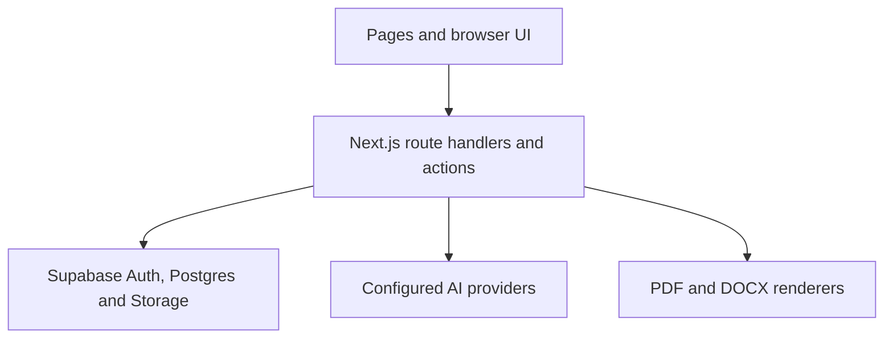

# Architecture

Production Baseline V1.0 · source `ed06ab8c6c73b63f7be2376e4a90b1e7ab3da342`.

Next.js App Router combines server-rendered pages, client interaction and Node route handlers. React components live under `components/`. Domain modules in `lib/` serve pages, route handlers and server actions. `types/careerProfile.ts` and `types/package.ts` define central data contracts. TypeScript path aliases come from `tsconfig.json`. `package-lock.json` fixes dependency resolution.

`middleware.ts` refreshes Supabase sessions and handles private-page redirects. Server code uses `lib/supabase/server.ts` for session-scoped access. Admin authorization uses `lib/admin/adminAuth.ts`. The server-only privileged client supports restricted database operations. Routes and actions must enforce authorization independently of navigation visibility.

The intake pipeline uses PDF extraction through unpdf and Word extraction through Mammoth before parsing resume information. The confirmed profile feeds `lib/careerProfileServiceContext.ts`, scoring modules, packages and document generation. Assessment rules live in `lib/gulfReadiness/`, `lib/jobMatch/` and `lib/optimizer/`. AI provider selection and execution are in `lib/ai/`. See [AI](AI.md).

The baseline exposes 63 available resume templates. The resume registry is `lib/templates.ts`; `lib/templateCatalog.ts` organizes selection. `lib/resumeDocument.ts` and `lib/packageResumeDocument.ts` build document data for the template components. The PDF handlers use `lib/pdf/renderPackage.ts`, a shared Chromium/Puppeteer browser in `lib/pdf/browser.ts`, and deployment-specific tracing in `next.config.mjs`. DOCX uses the independent Word renderer in `lib/resumeDocx.ts`. The package snapshot, current profile, visibility, style settings and photo access have separate roles in document assembly. Word and browser PDFs have different layout engines.

Supabase Postgres persists accounts, profiles, packages, assessments and artifacts. Supabase Storage handles private photo/audio objects; see [Database](DATABASE.md). Vercel deploys Git builds, with `vercel.json` defining the Mumbai region and retention schedule. GitHub Actions checks the package lock, source, test database, production build and browser behaviour.
