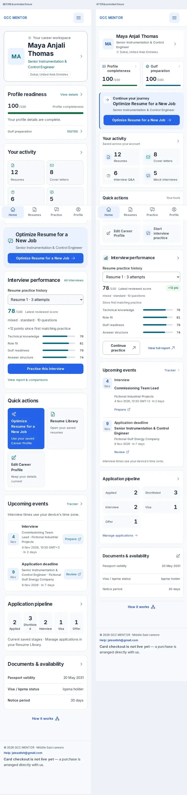

# DASHBOARD-003 — complete dashboard redesign

2 November 2026. Founder approved full frontend implementation on latest main e12f44b. Status: implemented; final51-state browser suite passed. Remote CI/merge/deployment gates remain pending.

## Scope and complete design

The actual /dashboard renders WorkspaceHome (app/dashboard/page.tsx supplies existing scores/counts/nextAction). Rebuild only its presentation and compact InterviewProgressOverview. Do not edit unused CareerHome/ActivityOverview/HomeFollowThrough components.

Mobile order: (1) compact identity, (2) two independent readiness links/bars, (3) Continue your journey, (4) saved activity counters, (5) four quick actions, (6) interview performance, (7) dates/reminders, (8) five application stages, (9) saved documents/availability, (10) existing guide trigger. White/light canvas, navy ink, neutral supporting copy, blue/teal actions and small functional colored icons; minimal borders/shadows. No decorative assets or gradients. Use existing global type tokens through scoped role aliases: candidate name19/20px semibold; section/card titles17/18; labels14; helper13/14; captions12/13; inputs16. No new global typography scale/important overrides. Keep AppShell header/bottom navigation unchanged.

Identity:48px photo/initials, real name/title/location,44px profile arrow, natural wrapping, no greeting. Readiness: two auto-fit cards with existing profile and Gulf numbers; narrow/enlarged-text cards stack. Keep score labels/calculations distinct. Next action: compact blue-tinted panel immediately after readiness, one primary CTA, existing urgent/pending/interview/workspace priority unchanged. Activity: four real saved totals in2x2 mobile/four columns desktop. Quick actions: four neutral icon rows/tiles linking existing optimize/library/profile/interview routes, no competing solid optimization CTA. Interview: same per-resume selection/calculated values, compact score/metric bars and report/practice links, concise loading/error/empty state. Events: real date column, separate event/job/company/time copy, action wraps below on narrow widths. Pipeline: five saved stages in wrapping2/3-column mobile grid, horizontal desktop. Documents: three concise definition rows, Not added when absent, same profile edit link. Guide remains existing collapsed dialog trigger.

Desktop: identity top; readiness and next action balanced at top; full-row activity; quick actions/interview in asymmetric columns; events in the supporting column and a full-width pipeline below; documents/support below. Align cards at start instead of equal-height stretching.

## Protected invariants

No changes to app/dashboard loading/fetch/decision code, lib, API, schema, auth, Supabase, prompts/models, scoring, credit/payment rules, templates/exports, tracker timezone/reminder functions, nextAction/unfinished interview choice, first-resume eligibility/dialog, existing route destinations or guide behavior. Add only a fourth shortcut linking the existing interview route. No hardcoded personal/business data. Existing loading/error/retry/empty states remain. Keep false unavailable values as dash, never zero or fabricated status.

## Acceptance and QA

All10 sections styled, complete top/middle/bottom visual inspection. Widths320/360/375/390/430/768/1024/1440 and200% text. Long names/titles/company/status, realistic activity, completed/comparable interviews, pending-review priority, unfinished interview continuation, dates, loading/error/missing/new-user states, keyboard focus,44px controls, no horizontal/text overlap/clipping or hidden-content workaround. Use controlled fictional fixtures if live authenticated access unavailable; no provider calls or production writes. Capture current baseline first, then after full-page/viewport screenshots and inspect actual images. Typecheck/lint/build/existing dashboard/navigation/required CI; diff protected scope. Branch+PR, merge only all required checks green; verify automatic Vercel status and inspect deployed content where authentication permits.

Expected files: components/studio/WorkspaceHome.tsx/.module.css; compact presentation in components/dashboard/InterviewProgressOverview.tsx; scoped role aliases only if needed; dashboard fixture/regression scripts; this doc, PROGRESS and decision log. Final report records exact touched files, ten-section outcomes, screenshots, actual tests and limits.

## Findings and implementation

The baseline rendered the candidate as a large page heading, repeated greeting, tall readiness detail list and prominent duplicated optimization tile. Pending action was below saved counters, pipeline stages were too narrow on phones, and equally bordered sections obscured priority. All ten sections now use the mobile order above. Identity is compact; readiness is two distinct linked bars; the existing context-aware action moves near the top; actual saved counts have small functional icons; four neutral shortcuts include the existing interview route; interview history remains comparable only within the selected resume; dates have wrapping company/time/action rows; five stages wrap naturally; documents show actual values or Not added; the existing guide stays closed until invoked.

References inspected live: https://menajobs.me/ (compact Inter hierarchy and restrained supporting copy); https://linear.app/docs/dashboards (grouped metrics, independent context and click-through); https://www.notion.com/help/navigate-with-the-sidebar (attention, tasks and shortcuts around stable navigation). Principles only; no copied branding/assets. Existing global Inter typography tokens remain the single source. Scoped aliases use card-title token17/18px for dashboard section headings and card-title+.125rem19/20px semibold for candidate identity. Labels14, helper13/14, captions12/13 and native16px form values reuse existing tokens. No global CSS or new dependency.

Actual visual QA caught inherited flex-column spacing creating a large CTA gap, narrow readiness labels, progress-color specificity and document labels clipping with doubled text. Corrections use explicit scoped flex direction, intrinsic grids/rem minimums, scoped pseudo-elements and wrapping definitions. No overflow hiding or fixed content heights.

## Verification record

- TypeScript, ESLint and final production build pass.
- npm test:89/89 checks pass; existing source guard covers51 routes,193 components and17 style sources.
- Existing workspace navigation:all7 widths and200% text pass, including keyboard account menu and zero writes.
- Existing dashboard page-typography:7 fixture states pass.
- Color-token contrast calculated from existing UI RGB tokens on white/canvas:muted6.12/5.80:1, supporting8.08/7.67:1, action6.70/6.35:1, teal6.24/5.92:1; all exceed4.5:1. These are token calculations, not a claim of exhaustive browser contrast scanning.
- Local full Studio regression attempted twice; intermittent timeouts on unchanged profile/report routes at final1440px. Do not count the full local suite as passed; required GitHub CI remains the release gate.
- Baseline screenshots:8 widths320/360/375/390/430/768/1024/1440. Final dashboard suite:51/51 states pass plus retry recovery, actual counters/readiness/date/time, per-resume selection/report routes and guide Escape/focus assertions; results below.
- Protected diff:app/dashboard/page.tsx, lib, API/backend, auth, Supabase, global typography, templates/PDF/document generators and navigation shell unchanged. Compact interview hooks/fetch/selection/calculations unchanged; its noncompact branch unchanged. No new runtime dependencies.
- Authenticated production /dashboard redirected to sign-in. No real account data accessed. Browser QA uses the actual production-built route/shell with controlled fictional API responses, Android Chrome UA/touch/mobile viewport emulation. This is not a physical Android device or authenticated production test. All outbound requests blocked and all API mutations rejected by the harness.

## Changed files

- components/studio/WorkspaceHome.tsx
- components/studio/WorkspaceHome.module.css
- components/dashboard/InterviewProgressOverview.tsx
- components/dashboard/InterviewProgressOverview.module.css
- scripts/verify-dashboard-v3.mjs
- scripts/verify-dashboard-ui.ts (missing-value presentation assertion)
- scripts/verify-page-typography.mjs (compact dashboard heading assertions)
- scripts/verify-workspace-navigation.mjs (compact identity assertion)
- docs/DASHBOARD_REDESIGN_3.md
- docs/PROGRESS.md
- docs/15_DECISION_LOG.md
- docs/dashboard-v3/ (dedicated before/after screenshots and QA summary)

Release:PR and automatic production deployment verification pending; never deploy manually or claim live authenticated visual coverage.

## Screenshot evidence and responsive coverage

Fictional candidate and saved activity are test data. Full-page captures include the existing AppShell and sticky bottom navigation; fixed navigation can appear partway down a stitched full-page capture. Separate top/middle/bottom viewport captures were inspected to verify content remains reachable above the bottom bar.

| Width | Saved dashboard | Long text | 200% text |
|---|---|---|---|
|320|Pass|Pass|Pass|
|360|Pass|Pass|Pass|
|375|Pass|Pass|Pass|
|390|Pass|Pass|Pass|
|430|Pass|Pass|Pass|
|768|Pass|Pass|Pass|
|1024|Pass|Pass|Pass|
|1440|Pass|Pass|Pass|

Additional empty/new/missing/thin/photo/pending/ongoing/error/loading states at320/390/1440:27 captures;51 after states total, no measured horizontal overflow, clipped leaf text, overlapping text ranges, undersized dashboard targets or runtime errors. No external requests or API writes. Exact summary: [qa-summary.json](dashboard-v3/qa-summary.json).

[Mobile before](dashboard-v3/before-390.webp) · [Mobile after](dashboard-v3/after-390.webp) · [Desktop before](dashboard-v3/before-1440.webp) · [Desktop after](dashboard-v3/after-1440.webp)

All after widths: [320](dashboard-v3/after-320.webp), [360](dashboard-v3/after-360.webp), [375](dashboard-v3/after-375.webp), [390](dashboard-v3/after-390.webp), [430](dashboard-v3/after-430.webp), [768](dashboard-v3/after-768.webp), [1024](dashboard-v3/after-1024.webp), [1440](dashboard-v3/after-1440.webp).
