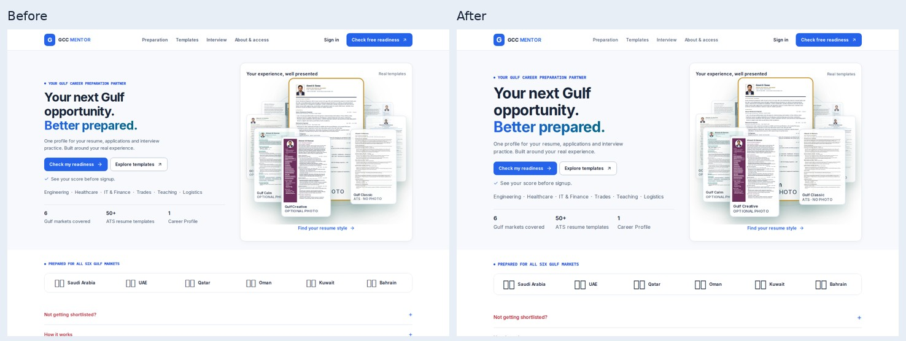
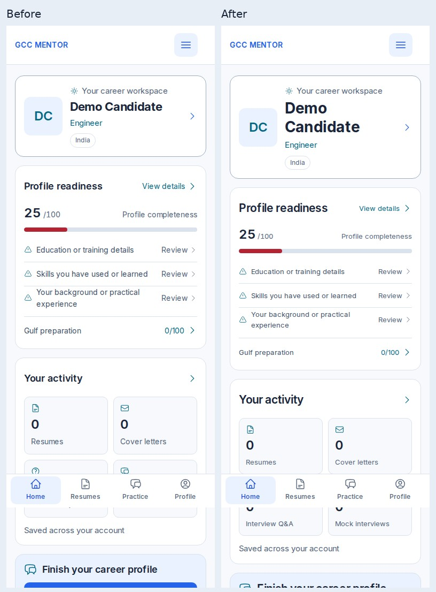

# Global application typography rebuild — 2 November 2026

MENAJOBS-TYPE-001. Baseline: main `42f1abd`. Presentation only. Release gate: required CI and mergeability; production verification is recorded separately in the PR/session handoff.

## Reference evidence

Inspected live https://menajobs.me/ and https://menajobs.me/extension in the cloud browser at1363×936. Values below are computed browser styles unless explicitly identified as source rules.

| Role | MenaJobs measured desktop treatment |
|---|---|
| Family | ui-sans-serif, system-ui, sans-serif, Apple Color Emoji, Segoe UI Emoji/Symbol, Noto Color Emoji |
| Home h1 |36px/40px,700,-.9px tracking,16px bottom margin|
| Extension h1 |48px/48px,800,-1.2px tracking,20px bottom margin|
| Extension h2 |30px/36px,700,-.75px tracking,8px bottom margin|
| Step card h3 |16px/24px,600,4px bottom margin|
| Navigation |14px/20px,500; primary actions600|
| Body / lead |16px/24px400;18px/28px400|
| Supporting text |14px/20px400|
| Text colors |Main rgb(15,23,41); muted rgb(107,114,128)|

Read responsive CSS source: home h1 text-3xl=1.875rem with1.2 line-height, md:text-4xl at48rem; extension text-3xl→sm:text-5xl at40rem; navigation larger layout at64rem. These are inspected source rules, **not a mobile rendered screenshot**. The cloud browser offers no viewport resize API; native mobile reference rendering remains unverified. Adopt the founder-approved fallback mobile scale rather than misrepresent inferred measurements. Reference screenshots: [home](typography-2026-11-02/menajobs-home-desktop-20261102.jpg), [extension](typography-2026-11-02/menajobs-extension-desktop-20261102.jpg).

Retain Inter (already bundled through next/font), GCC Mentor palette/layout/branding and established small mono details. No font dependency, branding or proprietary asset copied. MenaJobs principles adopted: compact controls, restrained emphasis, visible display/section/card hierarchy, regular readable body copy and short heading-description gaps. We deliberately keep700 display weight and the approved accessible palette rather than copying every reference choice.

## Problems traced and corrected

1. Multiple text-2xl–9xl utilities resolved to the same title, while a second stylesheet mapped them differently. Removed81 redundant declarations from ui-system.css; typography.css remains the scale owner. Compatibility utility caps remain intentional; semantic heading levels take precedence.
2. Career Studio section titles were explicitly reduced to body size. They now consume the section role.
3. Generic paragraph rules erased small text roles. Plain text-sm/xs paragraphs now use helper/caption roles; explicit type-* roles win mixed-class conflicts.
4. Auth display had a separate local size. It now uses page-title tokens.
5. Landing disclosure modules redeclared shared section-size tokens. Removed these local overrides.
6. Application pipeline dt labels collided on narrow screens. Caption role and word wrapping fix the text without changing stage values/layout logic.
7. Preparation demo retained inverse text over light surfaces. Text now consumes shared ink/muted/brand/status colors. Existing dark insets retain inverse text. Removed an invalid desktop background declaration that erased the dark hero overlay. Animation definitions/behavior unchanged.
8. Generated letter body inherited application body size. Marked its authored document boundary and preserved15px/1.55 across breakpoints; exports untouched.

## One shared scale

At16px root size; desktop starts768px. All values are rem-based and respect enlarged browser text.

| Role / token suffix | Mobile | Desktop | Weight |
|---|---:|---:|---:|
|hero-size|36|48|700|
|title-size|28|32|700|
|section-size|21|24|600|
|card-title-size|17|18|600|
|body-size / description-size / reading-size / lead-size|15|16|400|
|label-size|14|14|500|
|helper-size|13|14|400|
|button-size|14|15|600|
|caption-size|12|13|400|
|input-size|16|16|400|
|nav-size|14|14|500|

Tokens prefixed `--ui-`. Body line1.55; headings1.25; hero1.15; labels/actions1.4; inputs1.5. Heading tracking-.015em, marketing-.025em; body0. Immediate heading-description gap.5rem. H4–H6 consume body/label/helper aliases in internal UI. Palette remains app/ui-system.css; page CSS consumes these variables. Important declarations are retained where needed to defeat legacy inline/module/Tailwind text settings, with authored-document exclusions. No blanket important purge.

## Scope and changed files

Application presentation:

- app/typography.css — canonical roles, aliases, priorities, document protection.
- app/ui-system.css — remove competing global type declarations; preserve non-type properties.
- app/preparation-pack/explorer.module.css — text contrast and valid desktop overlay.
- components/journey/how-it-works.module.css — remove local section-token override.
- components/landing-premium/premium.module.css — remove local section-token override.
- components/service/CoverLetterEmail.tsx — authored document marker only.
- components/studio/WorkspaceHome.tsx — pipeline caption class only.
- components/studio/WorkspaceHome.module.css — pipeline label wrapping only.

Regression coverage:

- scripts/verify-typography-ui.mjs
- scripts/verify-mobile-layout.mjs
- scripts/verify-clear-path-ui.mjs
- scripts/verify-page-typography.mjs
- scripts/verify-career-studio.mjs
- scripts/verify-cta-alignment.mjs
- scripts/verify-workspace-navigation.mjs
- scripts/verify-preparation-experience.mjs
- scripts/verify-global-type-routes.mjs (new, built page and runtime fixtures)
- scripts/verify-typography-documents.mjs (new, exact baseline document comparison)

Documentation/evidence: this report, docs/TYPOGRAPHY_SYSTEM.md, docs/PROGRESS.md, docs/15_DECISION_LOG.md, docs/typography-2026-11-02/*.jpg and document-comparison.json.

No API, lib, auth, payment, schema, prompt, score, optimization, parsing, template, export or animation implementation changed. layout.tsx, globals.css, responsive.css and tailwind.config.ts were inspected and needed no edits.

## Before and after

Same1440px landing viewport and390px dashboard fixture. Moving resume orbit may show different designs between captures; it is intentionally unchanged. Container test font availability can omit emoji flag glyphs in both captures.

## Verification and honest limits

- TypeScript and lint passed. Production build passed with placeholder public configuration; no production credentials used.
- Deterministic/disposable-database suite89/89 passed during implementation. Required CI must independently pass on the final PR head.
- Shared typography roles at320/360/375/390/430/768/1440; hostile inline/utility styles, mixed text/semantic classes, token propagation, 16px fields and document exclusions passed.
- Mobile standard/200% text, CTA/form sizing, popup hierarchy, keyboard navigation, account menu and workspace reflow passed. Studio83 responsive/state checks passed with zero external calls.
- Processing320/1440: stable geometry across changing quotes/stages, real completion ticks, no overflow and reduced motion passed. No animation behavior edited.
- Real PDF/DOCX/paste intake with fictional local AI, parser failures, oversized/invalid files and retry passed. No live provider/account claim.
- Exact authored-document comparison:63 resume templates plus generated letter ×390/1440 =128 states; every element's typography and internal geometry equal before/after. Representative resume screenshots byte-identical; source diff0 for templates/PDF/letter export. [Full comparison results](typography-2026-11-02/document-comparison.json).
- Real PDF generation produced18 raw/optimized fixtures. Local Chromium149 heading extraction inserts spaces inside heading words; the unchanged baseline fails identically and9 baseline/new extracted texts are byte-identical. No export/checker logic changed. The required remote CI PDF checks remain mandatory; local PDF checks are **not** reported as passing.
- Auth form presentation was rendered with placeholder configuration, including reset-without-session presentation. No signup/reset/login submitted. Protected account/admin screens remain live-authentication unverified.
- Legal runtime pages with placeholder configuration returned branded404 because no published site content is available there; this is404 presentation evidence, **not legal-content verification**. Verify actual legal content on production after automatic deployment.
- No full WCAG certification: computed solid-background contrast scanning and screenshot review cover the inspected text; gradients, transparency, media backgrounds and assistive-technology behavior need separate assessment.

Final local release build:120 client states across24 routes at360/375/390/430/1440px, zero hierarchy/input/overflow/runtime failures and zero warnings in the limited opaque-background text contrast scan. Runtime22states at390/1440px:10 genuine auth-form states,10 legal404 screens (content unverified),2 admin sign-in walls (admin content unverified). [Exact route/state summary](typography-2026-11-02/route-summary.json). Public NaukriGulf/settings/payment server routes were unavailable in static fixtures; typography applies centrally but these authenticated contents remain unverified.

CI, PR merge and deployment results follow in the dated progress/release handoff. Do not infer a live deployment from a successful source build.
