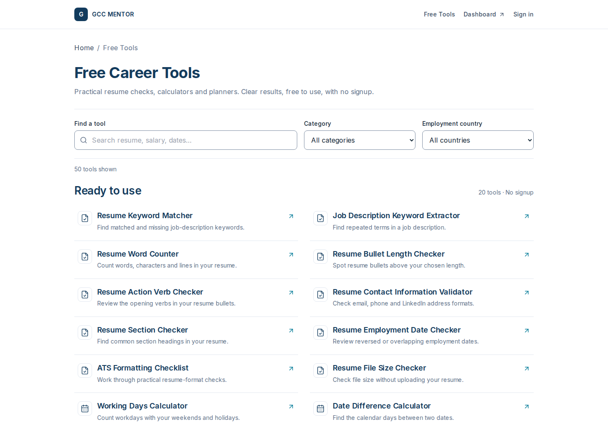
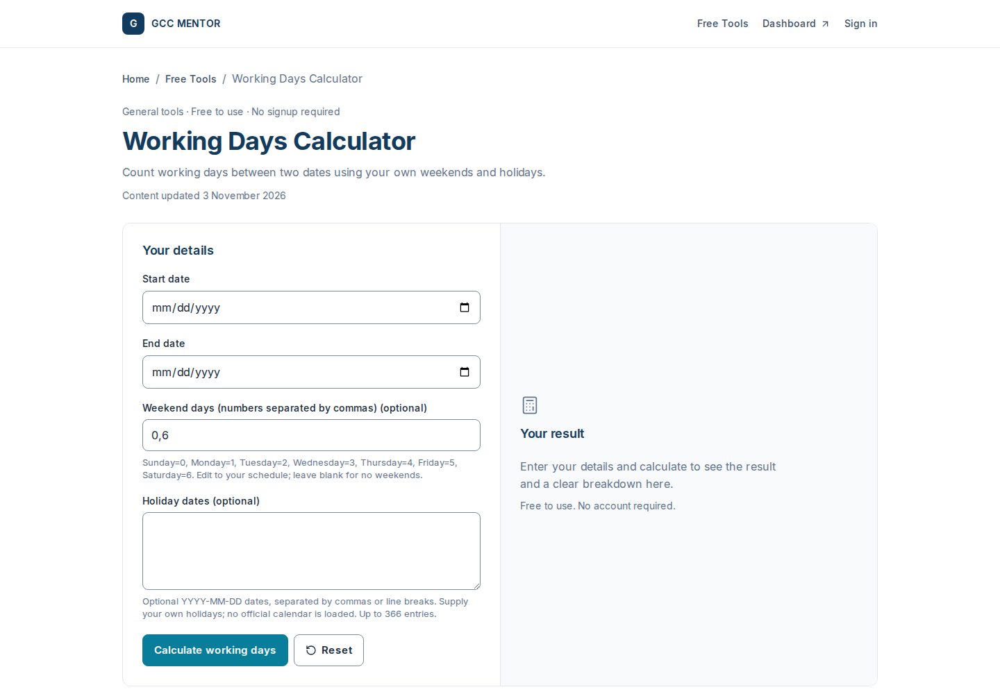

# Premium tools V1 — reference delivery, 4 November 2026

**Ready for founder visual review; not merged or in production.** [PR #70](https://github.com/jaissatish-web/GCC-MENTOR/pull/70), branch `design/premium-tools-reference-v1`; [implementation issue #69](https://github.com/jaissatish-web/GCC-MENTOR/issues/69). Verified application source `9b6a7a852d64b4eb3e97543c4c43e80ba98f515a`. Subsequent evidence commits do not change application code.

## 1–3. Problems, research and resulting design
Original hub: section-sized tool names, long descriptions, colored ordinary labels, tall repeated cards, and several introductory blocks before useful tools. Original detail: repeated promotion, weak result hierarchy and no reusable page-layout component. Source audit also found global important typography overriding module intent; independent SaaS style layers and mixed icon libraries remain tracked for later batches. [Full severity/file inventory](README.md#issue-inventory).

Current live MenaJobs homepage/directory and five tools were inspected with screenshots: working days, gratuity, keyword matcher, notice period and resignation letter. Its repeated breadcrumb/introduction/input/result/content order, aligned controls and persistent result placeholder work well. GCC uses these organizational principles with original navy/teal styling, flatter directory rows, plain availability, shorter tool-name titles and a single optional CTA outside results. No competitor assets, legal formulas or promotional claims were adopted. Desktop dropdown observed; competitor mobile menu was not directly inspected because cloud-browser viewport resizing was unavailable. Linear/Stripe/Vercel were aesthetic references, not independently audited products.

## 4. Foundation and shared components
Existing Inter and central typography ownership reused. Central `app/ui-system.css` contains opt-in reference palette/control tokens; `app/typography.css` owns responsive roles. The theme only activates on the hub/reference calculator, preserving other detail bodies until approval.

|Role|Value|
|---|---|
|Heading|#123B5D|
|Action|#087E9A|
|Text / secondary|#172B3A / #64748B|
|Surface / secondary|#FFFFFF / #F8FAFC|
|Divider / field boundary|#E2E8F0 / #7D8DA2|
|Success / warning / error|#137547 / #A35B08 / #B42332|
|Page / section / card, mobile|30 / 23 / 17px|
|Page / section / card, desktop|36 / 26 / 18px|
|Body / supporting / inputs|15–16 / 13–14 / 16px|
|Controls / panel radius|8 / 12px|
|Touch controls|46px minimum|

Components: `ToolHeader`, `ToolFooter` (native mobile menu), `ToolPageLayout` (server-rendered breadcrumb/title/content/FAQ/related links/one CTA), `ToolResult` (empty/success/breakdown/copy/print), updated `ToolCatalog` (search/category/country/empty state) and existing `ToolRunner` generic fields/validation/reset. Existing ToolCta auth lookup unchanged. No runtime dependency or framework added. No decorative gradients, animation library or shadows introduced. Shared tools chrome is foundation across50 routes; reference body styling is opt-in.

## 5–6. Counts and functional protection
**Hub +1 calculator body migrated. Remaining49 body migrations await approval.** Registry still has20 active tools and30 planned availability pages; no unavailable tool was silently enabled or omitted. All50 remain linked and retain their URLs.

**20 active tools tested** in40 hydrated viewport states; all50 reserved routes statically checked. Working Days Calculator additionally tested through7 complete sequences across all required widths: blank/reversed input errors,5working days for1–7June2026 with Saturday/Sunday weekends,4days after excluding1June, stale-result clearing, reset, copy, print and content-free events. All tests passed. Formula/spec/registry/AI/API/auth/database/payment/template sources untouched.

## 7–8. Screenshots, mobile and visual QA
Both reference pages passed320,360,390,430,768,1024,1440px:14 layouts; no overflow, clipped controls, unlabelled fields, browser errors, unexpected API calls or hydration errors. Native menu click/keyboard and200% text reflow passed. Numeric results and explanatory rows remain readable. Contrast measured: field boundary3.385:1, secondary text4.759:1 on white, white text on teal4.715:1. These checks do not establish complete WCAG/screen-reader compliance.

Before/after viewport captures use390×1000 and1440×1000. Result captures include the full page; large200% diagnostic captures are reproducible test outputs rather than committed review images.

|View|Before|After|
|---|---|---|
|Hub desktop|[Before](evidence/before-hub-1440-viewport.png)|[After](evidence/after-hub-1440.png)|
|Hub mobile|[Before](evidence/before-hub-390-viewport.png)|[After](evidence/after-hub-390.png)|
|Calculator desktop empty|[Before](evidence/before-working-days-1440-viewport.png)|[After](evidence/after-calculator-empty-1440.png)|
|Calculator mobile empty|[Before](evidence/before-working-days-390-viewport.png)|[After](evidence/after-calculator-empty-390.png)|
|Calculator result|—|[Desktop](evidence/after-calculator-result-1440.png) · [Mobile](evidence/after-calculator-result-390.png)|
|Mobile menu|—|[Open](evidence/after-mobile-menu-390.png)|

## 9. Measured performance
Lighthouse13.6.0/Chromium149, local production builds with the same actual DevTools throttling, one navigation run per page/form factor. Baseline main5c426c5; final9b6a7a8. Full config and repeatable commands in before/after lighthouse-summary.json. Earlier filmstrip-error and prefinal runs excluded. Host-load variance limits conclusions. No production performance certification.

|Page|Performance before → after|LCP before → after|TBT before → after|CLS before → after|
|---|---:|---:|---:|---:|
|Hub mobile|76 →84|2.267 →2.312s|885 →477ms|0 →0.00056|
|Calculator mobile|77 →88|2.206 →2.304s|801 →338ms|0 →0|
|Hub desktop|100 →100|0.194 →0.169s|38 →0ms|0 →0|
|Calculator desktop|100 →100|0.253 →0.158s|0 →0ms|0 →0|

All four final runs: accessibility100, best practices100, SEO100, zero audit errors. Mobile performance scores/TBT improved in these runs; mobile LCP slightly increased. Final lab LCP≤2.5s andCLS≤0.1. **Real75th-percentile Core Web Vitals andINP are unmeasured**; TBT is not INP. No claim of reduced JavaScript bytes or guaranteed speed improvement.

## 10–14. SEO, checks, GitHub, merge and deployment
All50 pages: unique titles/descriptions, matching canonical, H1, breadcrumb/application schema where appropriate, valid related links;20active indexable/sitemapped,30planned noindex/excluded from sitemap. Existing metadata/publication rules unchanged; no ranking promise.

Local typecheck/lint/production build and production dependency audit pass (0vulnerabilities).92 repository check scripts passed (89captured in the npm run output; the last3 were separately rerun and passed). Final browser suites passed. New strict reference regression is included in required CI. First PR commit passed required GitHub CI; final application/evidence commits must have their current CI state checked on PR#70 before any merge.

- Branch: `design/premium-tools-reference-v1`.
- PR: #70, open/draft; **not merged**, founder visual approval required.
- Final-code Vercel preview: https://gcc-mentor-lpm7hljt7-satishs-projects-c02c354b.vercel.app/tools (Vercel account access required).
- Vercel deployment `dpl_EsdfjJGZT7Fysufdu1J1mDp2LVaN`: READY, preview target (targetnull), correct9b6a7a8 source and project verified through connector. No production settings or environment changes.
- Production remains main5c426c5, READY; no reference production deployment claimed.

## 15. Status and approval requirements
|Work|Status|Next action|
|---|---|---|
|Live public/reference + repository audit|Completed with stated access limits|Internal live screens still need session evidence|
|Design tokens/shared foundation|Completed for reference scope|Founder review|
|Hub +1 calculator implementation/QA|Completed|Founder visual approval|
|Final required CI|In progress at report writing|Read latest PR checks; no merge pending/failed|
|Protected preview browser verification|Blocked|Authorize temporary23-hour preview share link for founder review/assistant testing|
|First PR merge/production verification|Blocked by visual gate|Approve references, green CI, then protected merge and automatic deployment verification|
|Remaining49 tool bodies|Not started|After visual approval|
|Main SaaS consistency rollout|Not started|After tools approval/completion; tracked issue#69|

The protected preview redirected the cloud browser to Vercel sign-in. Automatic approval review rejected the authenticated fetch because it would create/reuse a temporary share link and expand preview access without explicit sharing authorization. No workaround or security-setting change was attempted. A temporary link needs founder authorization; screenshot review can proceed without it. Signed-in SaaS workflows and real member sessions have not been visually/live verified.
