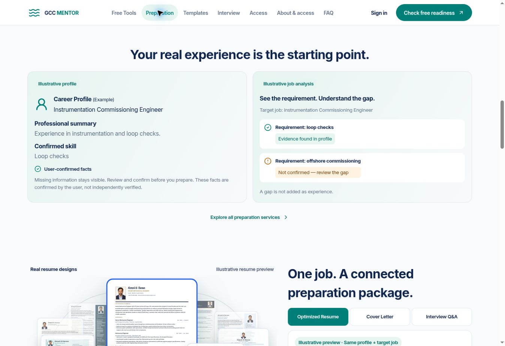
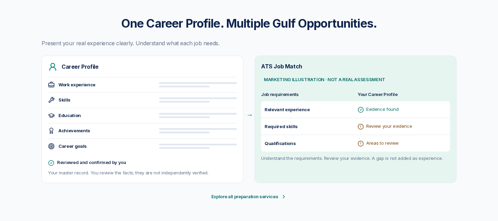
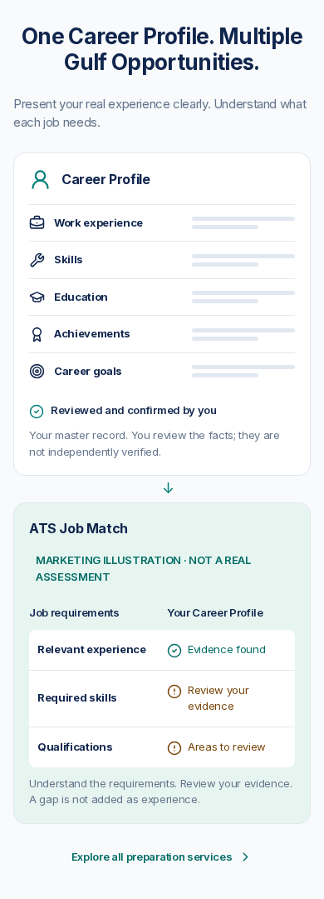
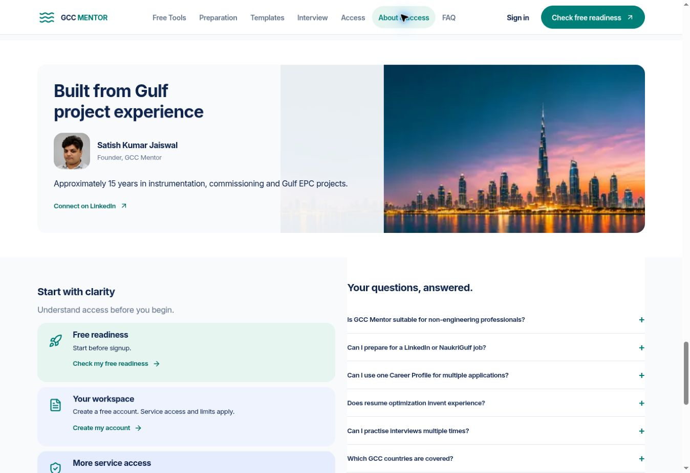
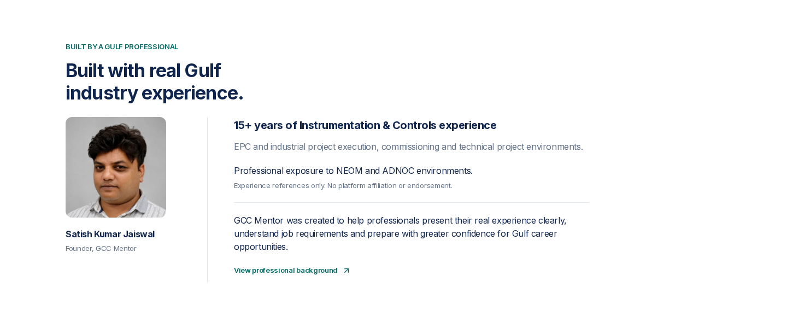
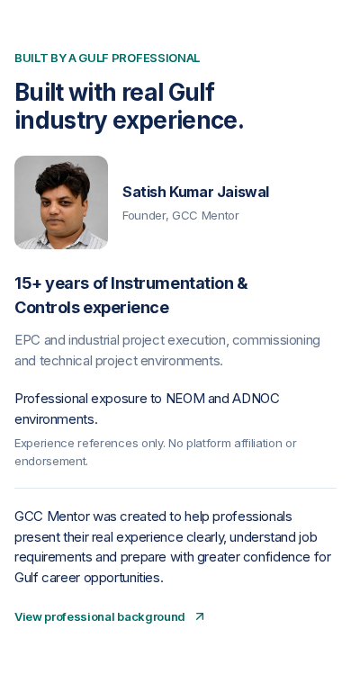
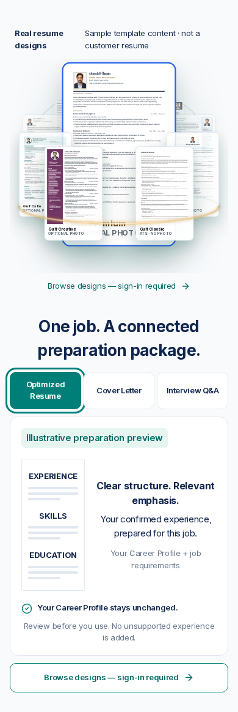

# Approved universal marketing and founder refinement — verification

16 November 2026. Base39e6e58. User approved mockups, implementation and merge.

## Implemented
Neutral Career Profile→ATS evidence illustration; neutral Resume/Cover Letter/Q&A tabs; interview answer framework and illustrative feedback; authentic founder portrait with concise confirmed experience; public globe label strings. Existing hero/flags/logos/candidates/journey/orbit/templates/globe/interview controls retained. No protected backend/document source or asset changed.

## Actual local results
- Baseline92/92; final npm test92/92 after fixing the central typography violation. npm build includes successful lint/type validation.
- RED: compiled old page lacked approved neutral heading. GREEN: new compiled story, all three package states and preserved controls.
- New320px word-legibility test RED; stacked narrow-width framework GREEN.
- Seven widths320/360/390/430/768/1024/1440 PASS: no page overflow, loaded imagery,5 profile categories/3 requirement rows, keyboard package selection, founder source/sizing, preserved candidate selection/menu/interview stages/globe.
- Normal/reduced motion and actual doubled text at320/390 PASS.
- Strict orbit front/rear depth, actual template keyboard selection/modal/Escape/animation PASS390/1440.
- Actual selected PDF download checks PASS for ats_classic/falcon_executive/emerald_professional, raw AND optimized: photo/no-photo/long CV (not all50+ templates).
- Independent source review found central-token violation and mobile word wrapping; both fixed without relaxing guardrails. FAQ stale Yes removed. No remaining known source-review findings.

## Screenshot evidence
Before JPGs are live production captures from Phase A at the cloud browser’s native viewport. After PNGs are compiled actual page/browser captures at explicitly named390/1440 widths, anonymous read-only API fixtures; not production/authenticated screenshots. The viewport differs between live-before and local-after. No generated mockup is used as verification evidence.

## Release gate and limits
Hosted preview/required CI and merge outcome are recorded in Work Report89 and PR. These local results do not certify paid AI, authenticated flows, database configuration, screen-reader compliance or field performance; those protected services were not changed or invoked. Local image fixture bypasses CDN resizing; original founder asset hash is separately asserted unchanged.

Rollback: revert the focused presentation PR commit using a new reviewed revert; preserve unrelated main changes. No database rollback. Previous known-good base39e6e58, production deploymentdpl_6vP64agHWdFgW18zfG3nP7vGGdcx.
