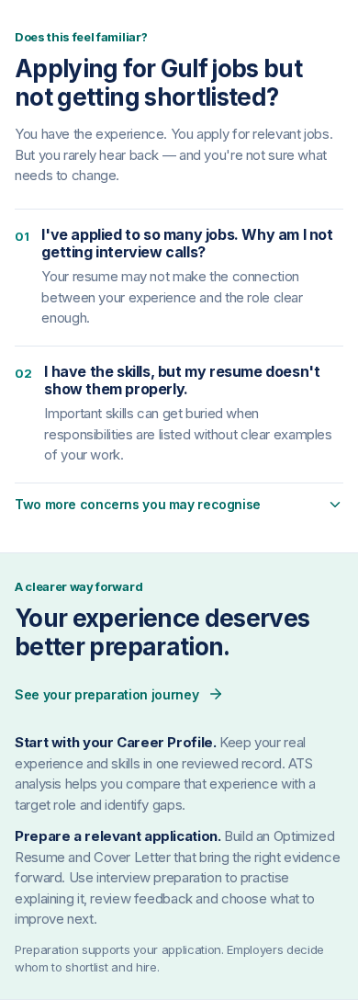
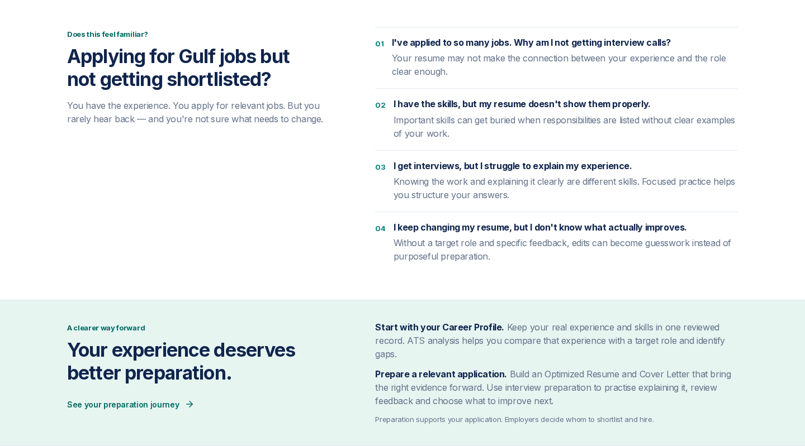

# V3 shortlisting preparation section — 16 November 2026

Founder-approved follow-up to released V3, main `b6667b0756cfeeb8bf91ea67474f55ff7c9f79ed` (tree `e8ccddca68f24dc1b7d210cca0a7f80e4423c970`). PR #88 is already merged; a focused follow-up PR is required. Work Report: [#89](https://github.com/jaissatish-web/GCC-MENTOR/issues/89). Do not merge or release without new explicit founder approval.

## Implemented order

Hero → GCC countries → both colorful employer marquees and disclaimer → candidate pain points → GCC Mentor solutions → Career journey → product demonstrations.

The old collapsed FAQ version is removed. The new headline, supporting paragraph and four concerns use the founder's exact copy; each has a short practical explanation. The solution bridge covers Career Profile, ATS analysis, Optimized Resume, Cover Letter and interview preparation, without a shortlisting/employment guarantee. Compact editorial rows use existing Executive Slate & Teal tokens. Mobile shows two concerns initially; the same keyboard-accessible button reveals/hides only the additional two. Desktop shows all four.

## Verification

- Baseline and final post-change full offline suites (`npm test`): **92/92 PASS** each.
- Compiled-page regression: **RED** on original V3 for missing candidate headline, then **GREEN** on implementation, including exact copy and required section order.
- Local production compilation/build: **PASS**, with the font fixture limitation below.
- TypeScript and lint: **PASS**, no lint warnings/errors (existing Next lint-command deprecation and npm proxy notices).
- Actual compiled-page browser matrix: **PASS** at 320/360/390/430/768/1024/1440 CSS px, DPR1. No document overflow, broken visible images, invalid anchors or page errors. Checks retain original navigation, menu/Escape, package tabs, interview controls/progress, ten resume orbit faces and Gulf selection; original routes remain available.
- New disclosure behavior: keyboard Enter, aria-expanded, focus retention, extra concerns hidden after collapse, first two concerns/solution always present, all four visible at desktop widths: **PASS**.
- Enlarged text: mobile expanded concerns at measured 2× computed text size, plus existing root 200% text check: **PASS**, no horizontal overflow or story text clipping.
- Fresh 390px/1440px screenshots visually inspected. These capture the compiled application with anonymous local API/image fixtures and reduced motion; they are not live production captures.
- Independent read-only review: no Critical/Important source issue. Minor regression-coverage suggestions addressed (exact support/explanations, collapsed visibility and expanded enlarged text). Reviewer did not execute the later browser run; the lead did.

## Screenshots

## Scope and limits

No resume templates, document typography, resume previews/PDF code, AI services, auth, backend, database/configuration, dependencies, marquees, orbit or globe sources changed. No paid AI/service calls. Source comparison and local verification do not certify signed-in generation, actual production network/CDN delivery, screen readers or physical devices.

Google font fetching stalled in this restricted local environment. The successful build used Next's local font-response fixture with existing V3 CSS/font bytes; application layout/font source and configuration are unchanged. The system Chromium launcher failed before opening a page; the bundled repository Chromium successfully ran the matrix. These are environment workarounds, not product fixes. Remote CI/build status must be checked separately.

Rollback: close the unmerged follow-up PR to leave production unchanged. After a separately approved release, revert only this change through a reviewed PR; no database rollback is needed.
