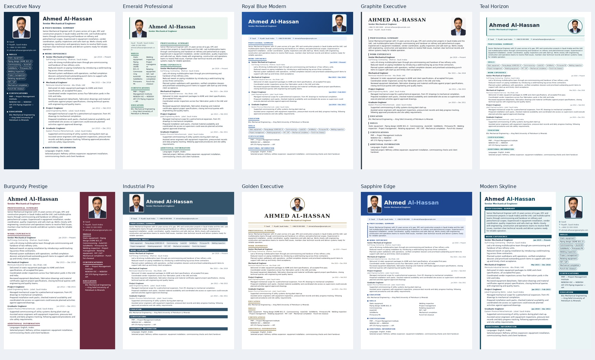

# Ten premium visual resume designs — VISUAL-010

23 October 2026. Review branch: `feat/premium-visual-resume-templates`. No merge into main or production release is authorized. Baseline: main `ce8c2b840037845296325cbf7aec738a55577899`.

These original designs reuse the existing shared engine, canonical ResumeDocument, shared gallery candidate, customization controls, template validation, save API, reader/scaling and Chromium PDF download. Numeric 54–63 are positions only; stored IDs follow existing permanent snake_case conventions. No candidate data, engine, existing template/theme, API, database, AI, auth, billing, editor, export implementation or global style was changed.



| Position | Name | Permanent ID | Full-size screenshot |
|---|---|---|---|
| 54 | Executive Navy | `executive_navy` | [Open](previews/executive_navy.png) |
| 55 | Emerald Professional | `emerald_professional` | [Open](previews/emerald_professional.png) |
| 56 | Royal Blue Modern | `royal_blue_modern` | [Open](previews/royal_blue_modern.png) |
| 57 | Graphite Executive | `graphite_executive` | [Open](previews/graphite_executive.png) |
| 58 | Teal Horizon | `teal_horizon` | [Open](previews/teal_horizon.png) |
| 59 | Burgundy Prestige | `burgundy_prestige` | [Open](previews/burgundy_prestige.png) |
| 60 | Industrial Pro | `industrial_pro` | [Open](previews/industrial_pro.png) |
| 61 | Golden Executive | `golden_executive` | [Open](previews/golden_executive.png) |
| 62 | Sapphire Edge | `sapphire_edge` | [Open](previews/sapphire_edge.png) |
| 63 | Modern Skyline | `modern_skyline` | [Open](previews/modern_skyline.png) |

## Data, settings and workflows

The exact `SAMPLE_RESUME_DOCUMENT` remains unchanged. Only ten new presentation-fit entries were added to `SAMPLE_TEMPLATE_SCALES`; original 53 fit values are untouched. Fit scales apply only to the existing one-page gallery sample, never user resumes or PDF content. Real resumes use readable 10.5pt body type at the default setting and can continue onto further pages.

Every new entry is version 1, available, photo-capable and styleable. Existing font, size, accent, ink, highlight, borders, header and photo settings are inherited from `applyStyleOverrides`; existing applicability remains (for example filled sidebars do not offer a header-band change). Section/category visibility, ordering and all existing optional-data rules stay in the common document and engine. No new settings or required fields.

Each description says **Modern Visual — Direct Application / Reference**, recommends direct recruiter/hiring-manager sharing, and recommends an ATS-friendly layout for online applications. `atsLevel: 'visual'` honestly distinguishes these entries without changing the picker. They are not certified universally ATS compatible.

DOCX behavior remains unchanged: supported optimized resumes use the existing content-oriented Word builder; it does not reproduce these graphic designs. Base Career Profile Word download stays unavailable under the existing rule. No new Word-layout promise.

## Executed verification

- Typecheck and lint passed; production build passed locally.
- Shared quality suite: all 63 × 20 visibility combinations × photo shown/hidden, plus 29 existing style choices, passed.
- New content suite: 992 renders passed across the ten requested professional personas, profile and optimized sources, photo settings, long/missing fields, special characters, all style options, old/frozen snapshots and six custom-category anchors. Test persona mutations exist only in tests. This checks text survival, not universal font/language coverage.
- Browser showcase check: all 63 share the same sample content; photos load without cropping; A4 sample bounds/fill passed with production CSS. Ten new full-page screenshots are above.
- Actual PackageScreen with synthetic intercepted APIs: all ten × base and optimized select/customize/save/reload passed; save payloads contain presentation metadata and preserve frozen content; PDF link disabled/enabled at the existing save gate; switching back preserves facts. All original 53 IDs also passed select/save/reload (alternating profile/optimized fixtures).
- Responsive actual UI: all ten × 360/390/430/768/1440px passed thumbnail/editor preview, sticky save/download controls, full-size reader Fit/Close and no document horizontal overflow. A stale test-label assertion in the initial combined run was corrected in the new harness; the full responsive portion then passed independently.
- Existing Word smoke check passed (valid DOCX, content present); actual Word API synthetic ownership/authentication/edited snapshot/blank-headline checks passed.

- New-theme PDF suite: **30/30 optimized** and **30/30 base-profile** PDFs passed (with photo, without photo and an eight-page stress resume per design), exercising the real download implementation. No stranded job/section headings or excessive blank page feet in the stress files. Visual review covered every new first-page PDF and representative continuation pages.
- All-template PDF regression: 189 PDFs exercised; 186 passed. Three failures are the existing Tech Horizon email extraction behavior described below and reproduced on clean main.
- Golden comparison: all 63 passed 512 sampled visibility masks plus 19 style variants per template. All original 53 stored fingerprints remained unchanged; new records additionally capture all 32,768 visibility combinations.
- Final full repository suite: **77/77 checks passed** after extending the expected registry count and exact metadata-search fixtures for the ten new entries. Typecheck/lint and final production build passed. See [verification transcript](verification.txt).

## Known limits

The all-template real-PDF suite reports three failures for the **unchanged existing `tech_horizon`**: its fixture email wraps and the ATS extraction check does not recognize it (photo/no-photo/long variants). These exact three failures were independently reproduced on clean baseline main `ce8c2b8`, using the same browser. No original template was altered to resolve this out-of-scope issue. The other 52 original templates pass the PDF suite. Two previously documented original left rails (`technical_sidebar`, `creative_gcc`) retain their known rail-before-name PDF reading order; the test reports notes for them.

Browser save tests use actual components and synthetic persistence; they do not certify authenticated live database writes, production storage signing, a real user's download HTTP request, or every browser/device. PDF tests exercise the real `renderPackagePdf` download implementation with existing fixture data and a database stand-in; only browser provisioning is environment-specific (packaged Chromium 149). No production candidate or account was modified and no AI calls were made.

## Reproduce

```bash
npm run typecheck
npm run lint
npm test
npm run build
node_modules/.bin/sucrase-node scripts/verify-visual-templates.ts
CHROME_PATH=/path/to/chrome node scripts/verify-visual-template-workflow.mjs
CHROME_PATH=/path/to/chrome node_modules/.bin/sucrase-node scripts/verify-template-showcase.ts --browser
CHROME_PATH=/path/to/chrome OUT=artifacts/visual-template-gallery node_modules/.bin/sucrase-node scripts/render-visual-template-previews.ts
node_modules/.bin/sucrase-node scripts/verify-template-pdfs.ts
```

The PDF launcher follows the existing local-Chrome/serverless discovery; CHROME_PATH is supported by the new browser scripts, not a newly added application setting. In this container the existing packaged Chromium was used through `VERCEL=1` for PDF fixtures; that is a local test switch, not a deployment.

## Changed files

Application/integration only:
- `components/templates/visualThemes.ts` — ten new themes, no renderer duplication.
- `lib/templates.ts` — ten permanent IDs/entries, import and visual ATS metadata type.
- `lib/sampleResume.ts` — ten new gallery-fit numbers only.

QA/documentation:
- `scripts/verify-visual-templates.ts` — new content/persona/settings regressions.
- `scripts/verify-visual-template-workflow.mjs` — actual UI synthetic save/mobile checks.
- `scripts/render-visual-template-previews.ts` — shared-sample A4 screenshots and bounds.
- `scripts/verify-career-profile-resume.ts` — update expected registry size from 53 to 63; same checks now cover all 315 candidate/template combinations.
- `scripts/verify-template-catalog.ts` — extend exact expected keyword matches to the new descriptions; search implementation unchanged.
- `scripts/run-checks.mjs` — register the new deterministic content suite.
- `scripts/engine-templates.golden.json` — append new design fingerprints only; old 53 retained.
- `docs/08_RESUME_ENGINE.md`, `docs/15_DECISION_LOG.md`, `docs/PROGRESS.md` — authorized scope before code and final evidence.
- `docs/visual-templates/README.md`, `docs/visual-templates/verification.txt`, `docs/visual-templates/previews/*` — this report, verification transcript and eleven preview images.

## Review handoff

Draft PR: https://github.com/jaissatish-web/GCC-MENTOR/pull/30

Implementation commit: `f27412edb6cc604aec8e2789be449f68df992193`. Documentation-only completion records may follow it.

Vercel preview deployment **READY**, exact implementation commit `f27412e`, ID `dpl_HFNVdNZpMQvoukxxFLU8XpvpuUsY`, existing project/team, `target: null` (preview). URL: https://gcc-mentor-85xlvox69-satishs-projects-c02c354b.vercel.app/templates .

**Preview runtime limitation:** fetching that page returned HTTP503: `Supabase is not configured. See docs/INFRASTRUCTURE.md §5.` The build succeeds, but the existing preview environment cannot serve the app without its existing authentication configuration. No environment variables, credentials, authentication code or production settings were changed to work around it. Use the committed screenshots for design review. This is not a successful live preview journey.

GitHub CI run444 was in progress at handoff; local77/77 checks passed. CI is separate evidence and is not claimed passed here.

All verification above is local source/synthetic/PDF evidence; it is not authenticated production certification. Founder review and explicit approval are still required before a main merge or production release.
